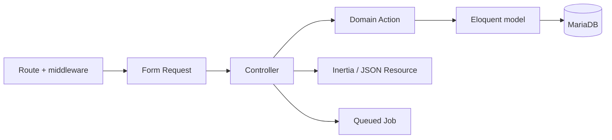

# Backend Sikompen

## Teknologi dan batas tanggung jawab

Backend memakai Laravel 13 dan PHP 8.4, MariaDB, database queue, PhpSpreadsheet, dan Dompdf. Laravel mengelola autentikasi, otorisasi, validasi, lifecycle data, file private, queue, scheduler, serta respons Inertia/JSON. React tidak mengakses database atau storage secara langsung.

## Akses dan identitas

| Actor | Mekanisme | Batas utama |
| --- | --- | --- |
| Admin reguler | Guard `admin`, tabel `sikompen_admins` | Mengelola data, file, SP, retensi, dan reset mahasiswa. |
| Admin emergency | Guard admin dengan flag emergency | Hanya area recovery: menerbitkan/membatalkan kode reset admin reguler. |
| Mahasiswa | Guard `student`, akun diprovisikan dari roster aktif | Hanya melihat record NIM sendiri setelah mengganti password awal. |
| Client API | Bearer token | Allowlist IP dan rate limit dari environment server. |

Password awal mahasiswa adalah NIM. Akun hanya dapat melihat data setelah password awal diganti. Jika NIM tidak lagi berada dalam roster aktif untuk periode akses, session mahasiswa tidak dapat melanjutkan akses.

## Surface HTTP

| Surface | Tujuan |
| --- | --- |
| `/` | Pemilih akses admin/mahasiswa. |
| `/admin` | Panel operasional admin; `/admin/kompen-respon` adalah route legacy. |
| `/mahasiswa`, `/kompen-respon`, `/mahasiswa/profil` | Data mahasiswa read-only berdasarkan session. |
| `/admin/settings`, `/admin/recovery`, `/admin/student-password-resets` | Pengaturan kredensial, recovery emergency, dan reset mahasiswa. |
| `/api/kompen-respon/*` | API internal berbasis session untuk filter, mahasiswa, dan detail. |
| `/api/sikompen/v1/*` | API outbound berbasis bearer token; lihat kontrak API. |

`KompenResponHubTableRequest` menormalisasi filter dan pagination. Semua mutasi memakai Form Request, middleware akses, dan pencatatan aktivitas ketika perubahan tersebut bersifat bisnis/operasional.

## Domain utama

| Area | Action / komponen penting |
| --- | --- |
| Workbook Kompen/Respon | `ParseKompenResponHubWorkbook`, `ValidateKompenResponHubWorkbookArchive`, `ImportKompenResponHubWorkbook`, `ActivateKompenResponHubImportVersion`, `ReleaseKompenResponHubImportVersion`. |
| Roster mahasiswa aktif | `ParseKompenResponHubActiveStudentWorkbook`, `ImportKompenResponHubActiveStudents`, `ActivateKompenResponHubActiveStudentImport`. |
| Query dan konsistensi | `KompenResponHubDataQuery`, `BuildKompenResponHubDataConsistencyReport`. |
| Lifecycle Kompen/SP | `FinalizeKompenResponHubCutoff`, progress dan override melalui controller lifecycle. |
| File dan audit | `BuildKompenResponHubExport`, `RecordKompenResponHubActivity`. |
| API massal | `GenerateKompenResponHubApiSyncArtifact`. |

## State data penting

| Model/kelompok | Tanggung jawab |
| --- | --- |
| `KompenResponHubImport`, `KompenResponHubActiveImport` | Versi workbook dan pointer aktif per periode. |
| `KompenResponHubActiveStudentImport`, `...Reference`, `...Student` | Versi roster, pointer aktif per periode, dan baris roster. |
| `KompenResponHubStudent`, `KompenResponHubDetail` | Data operasional hasil workbook aktif. |
| `...StudentProgress`, `...StudentSummaryOverride`, `...DetailOverride` | Lapisan nilai efektif tanpa mengubah sumber workbook. |
| `...PeriodCutoff`, `...WarningLetter` | Cutoff dan lifecycle SP. |
| `...ImportTask`, `...ActiveStudentImportTask`, `...ExportTask`, `...ApiSyncRun` | State pekerjaan asynchronous. |
| `...ImportAuditLog`, `...ActivityLog`, `...SystemSetting` | Jejak lifecycle file, aktivitas domain, dan kebijakan retensi. |

Semua model domain memakai koneksi `config('kompen-respon-hub.database_connection')`.

## Keamanan

- Archive XLSX diperiksa sebelum PhpSpreadsheet membaca isi: batas ukuran, entry, rasio kompresi, path, required Office XML, dan formula.
- Input pencarian/alasan dibatasi `SafeSearchTerm`; nilai query diparameterisasi melalui Eloquent/query builder.
- Workbook, ekspor, dan artifact sync berada di storage private. Download selalu melalui controller yang memeriksa akses.
- Poll/download ekspor memerlukan token acak dan session pembuat task.
- API outbound memverifikasi bearer token, scope, dan limiter sebelum controller dipanggil. IP egress adalah lapis tambahan opsional per client: bila `allowed_ips` tidak kosong, kecocokan IP/CIDR juga wajib; bila kosong, autentikasi memakai token unik saja. Konfigurasi client berada pada environment server, bukan panel aplikasi atau database operasional.
- Riwayat aktivitas menyaring kredensial dan membatasi payload audit agar informasi sensitif tidak dicatat mentah.

## Aturan perubahan backend

1. Letakkan validasi di Form Request dan otorisasi di middleware/policy akses yang ada.
2. Gunakan `KompenResponHubDataQuery` jika perilaku data harus sama pada tabel, API internal, dan ekspor.
3. Gunakan `RecordKompenResponHubActivity` untuk mutasi domain yang perlu diaudit.
4. Jika route/controller berubah, generate ulang Wayfinder dan sesuaikan type/frontend.
5. Jalankan Pint, test feature yang paling sempit, dan static analysis yang relevan setelah perubahan PHP.
