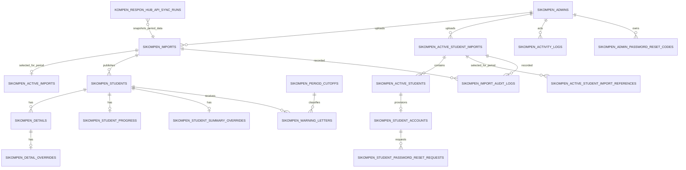

# ERD Sikompen

Tabel domain memakai koneksi Sikompen. File XLSX, PDF ekspor, dan NDJSON.GZ tidak disimpan sebagai BLOB di database; record menyimpan metadata dan path private storage.

## Cara membaca ERD

### Sumber dan versi file

`sikompen_imports` adalah versi workbook Kompen/Respon. `sikompen_active_imports` adalah pointer yang memilih satu versi aktif pada suatu periode. Saat pointer berubah, data `sikompen_students` dan `sikompen_details` periode tersebut dibangun ulang dari workbook pilihan.

`sikompen_active_student_imports` adalah versi roster mahasiswa aktif. Pointer-nya tersimpan terpisah di `sikompen_active_student_import_references`. Roster tidak menimpa data Kompen/Respon; ia dipakai untuk akun mahasiswa dan laporan konsistensi NIM.

Kedua jenis file dapat berada pada periode sama tetapi tetap independen. Versi inactive boleh dipindah ke recycle bin dan dipulihkan selama retensi belum berakhir.

### Data operasional dan koreksi

`sikompen_students` menyimpan ringkasan per mahasiswa/periode, sedangkan `sikompen_details` menyimpan detail sumber. Progress dan override berada pada tabel sendiri agar nilai workbook asli tetap dapat diaudit.

- `sikompen_student_progress`: jam yang sudah dikerjakan.
- `sikompen_student_summary_overrides`: koreksi total ringkasan.
- `sikompen_detail_overrides`: koreksi per detail berbasis source key.

Nilai efektif yang ditampilkan, diekspor, dan dipakai SP dibentuk dari sumber + progress/override, bukan dengan mengubah baris workbook awal.

### Surat Peringatan dan akun

`sikompen_period_cutoffs` menyimpan cutoff per periode. Ketika difinalisasi, kandidat dengan sisa hutang dapat menghasilkan `sikompen_warning_letters`. Riwayat SP tetap ada ketika diselesaikan atau rollback agar keputusan dapat diaudit.

`sikompen_student_accounts` terhubung ke NIM roster aktif. Permintaan reset mahasiswa ada di `sikompen_student_password_reset_requests`; kode berlaku 24 jam, dapat direfresh atau dihapus admin.

### Audit dan pekerjaan asynchronous

`sikompen_import_audit_logs` mencatat lifecycle file. `sikompen_activity_logs` mencatat tindakan domain admin/system, bukan aktivitas login mahasiswa. `sikompen_system_settings` menyimpan kebijakan retensi yang dikelola admin.

Task impor dan ekspor memiliki tabel sendiri. API bulk memakai `kompen_respon_hub_api_sync_runs` untuk selector, snapshot, status, checksum, ukuran artifact, dan masa berlaku. Client API runtime dibaca dari environment `SIKOMPEN_API_CLIENTS_JSON`, bukan dari panel aplikasi.

## Kelompok entitas

| Kelompok | Entitas | Catatan |
| --- | --- | --- |
| Admin | `sikompen_admins`, `sikompen_admin_setup_windows`, `sikompen_admin_password_reset_codes` | Admin emergency ditandai pada akun dan dibatasi ke recovery. |
| Workbook | `sikompen_imports`, `sikompen_active_imports`, `sikompen_import_tasks` | Satu pointer workbook aktif per `periode_semester`; import mendukung soft delete. |
| Roster | `sikompen_active_student_imports`, `..._tasks`, `..._students`, `..._references`, `..._sources` | Satu pointer roster aktif per periode; import mendukung soft delete/recycle bin. |
| Operasional | `sikompen_students`, `sikompen_details`, `..._progress`, `..._summary_overrides`, `..._detail_overrides` | Nilai efektif dibentuk dari sumber dan layer progress/override. |
| SP | `sikompen_period_cutoffs`, `sikompen_warning_letters` | Cutoff dan keputusan/finalisasi SP per periode. |
| Akun mahasiswa | `sikompen_student_accounts`, `sikompen_student_password_reset_requests` | Akses bergantung roster aktif dan password-change gate. |
| Audit/retensi | `sikompen_import_audit_logs`, `sikompen_activity_logs`, `sikompen_system_settings` | Settings menyimpan tiga retensi yang dapat diubah admin. |
| Task | `sikompen_export_tasks` | Token akses + session pembuat melindungi export task. |
| API outbound | `kompen_respon_hub_api_sync_runs` | Client runtime dikonfigurasi dari environment. Run menyimpan `api_client_key`, selector, snapshot, dan metadata artifact. |

## Identitas dan indeks penting

- Workbook dan roster dipilih unik per `periode_semester` melalui tabel reference/pointer masing-masing.
- Request selector sama dari client yang sama digabung selama run masih `queued`, `processing`, atau artifact `ready` belum kedaluwarsa; `run_id` adalah ULID yang dipakai pada endpoint.
- Data operasional/override/progress diidentifikasi agar tetap dapat diselaraskan ketika workbook periode yang sama diganti.
- Import audit log menyimpan salah satu referensi sumber (`source_import_id` atau `source_active_student_import_id`) plus metadata snapshot.
- Recycle bin menggunakan soft delete pada versi file; file private baru dihapus permanent oleh command purge setelah retensi.

## Penyimpanan file

Database tidak menyimpan XLSX, PDF, atau NDJSON gzip sebagai BLOB. Path file private tersimpan bersama metadata/checksum; controller/job yang tepat melakukan baca, unduh, atau purge.
