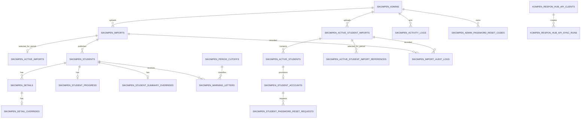

# ERD Sikompen

Tabel domain memakai koneksi Sikompen. Sebagian besar bernama `sikompen_*`; API client dan sync run saat ini memakai tabel `kompen_respon_hub_*`.

## Kelompok entitas

| Kelompok | Entitas | Catatan |
| --- | --- | --- |
| Admin | `sikompen_admins`, `sikompen_admin_setup_windows`, `sikompen_admin_password_reset_codes` | Admin emergency ditandai pada akun dan dibatasi ke recovery. |
| Workbook | `sikompen_imports`, `sikompen_active_imports`, `sikompen_import_tasks` | Satu pointer workbook aktif per `periode_semester`; import mendukung soft delete. |
| Roster | `sikompen_active_student_imports`, `..._tasks`, `..._students`, `..._references`, `..._sources` | Satu pointer roster aktif per periode; import mendukung soft delete/recycle bin. |
| Operasional | `sikompen_students`, `sikompen_details`, `..._progress`, `..._summary_overrides`, `..._detail_overrides` | Nilai efektif dibentuk dari sumber dan layer progress/override. |
| SP | `sikompen_period_cutoffs`, `sikompen_warning_letters` | Cutoff dan keputusan/finalisasi SP per periode. |
| Akun mahasiswa | `sikompen_student_accounts`, `sikompen_student_password_reset_requests` | Akses bergantung roster aktif dan password-change gate. |
| Audit/retensi | `sikompen_import_audit_logs`, `sikompen_activity_logs`, `sikompen_system_settings` | Settings menyimpan tiga retensi yang dapat diubah admin. |
| Task | `sikompen_export_tasks` | Token akses + session pembuat melindungi export task. |
| API outbound | `kompen_respon_hub_api_clients`, `kompen_respon_hub_api_sync_runs` | Client memiliki token hash, scope, allowlist IP; run memiliki selector dan artifact metadata. |

## Identitas dan indeks penting

- Workbook dan roster dipilih unik per `periode_semester` melalui tabel reference/pointer masing-masing.
- API sync run unik per pasangan client dan `idempotency_key`; `run_id` adalah ULID yang dipakai pada endpoint.
- Data operasional/override/progress diidentifikasi agar tetap dapat diselaraskan ketika workbook periode yang sama diganti.
- Import audit log menyimpan salah satu referensi sumber (`source_import_id` atau `source_active_student_import_id`) plus metadata snapshot.
- Recycle bin menggunakan soft delete pada versi file; file private baru dihapus permanent oleh command purge setelah retensi.

## Penyimpanan file

Database tidak menyimpan XLSX, PDF, atau NDJSON gzip sebagai BLOB. Path file private tersimpan bersama metadata/checksum; controller/job yang tepat melakukan baca, unduh, atau purge.
