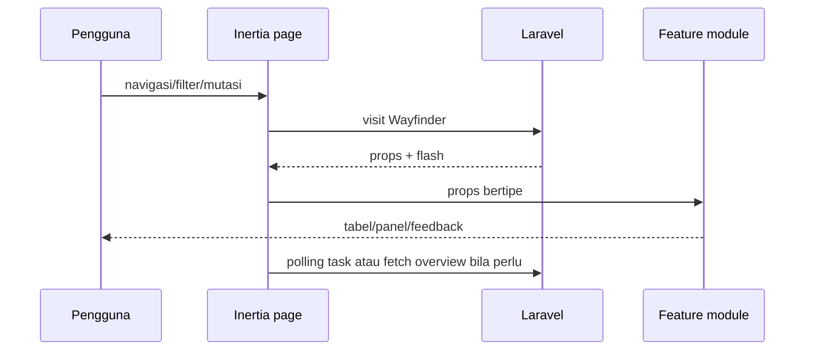

# Arsitektur Frontend Sikompen

## Tujuan

Frontend menyajikan panel operasional yang cepat dibaca dan aman untuk dua peran: admin yang mengelola sumber data/lifecycle, serta mahasiswa yang melihat data sendiri. Halaman utama berperan sebagai orchestrator; tabel, form, dan panel domain berada dalam feature module.

```text
resources/js/
├── app.tsx
├── pages/
│   ├── welcome.tsx
│   ├── kompen-respon-hub/index.tsx
│   ├── mahasiswa/profile.tsx
│   ├── admin/{settings,student-password-resets,emergency-recovery}.tsx
│   └── auth/ (login, setup, password, reset)
├── features/kompen-respon-hub/
│   ├── upload/                 # workbook + roster aktif
│   ├── kompen-respon/          # ringkasan dan koreksi
│   ├── detail-kompen/
│   ├── list-file/              # versi, consistency, recycle bin
│   ├── log-upload/, surat-peringatan/, riwayat-aktivitas/
│   ├── export/, dashboard/, shared/
├── components/ui/
├── hooks/, lib/, types/
└── actions/, routes/, wayfinder/ # generated
```

## Batas tanggung jawab

- Laravel menentukan akses, validasi, filter, pagination, dan bentuk data; React tidak menduplikasi otorisasi atau aturan bisnis.
- Props Inertia memuat data untuk tab aktif. `index.tsx` memilih feature yang dirender dari `activeTab`.
- Mutation menggunakan `<Link>`, `router`, atau action Wayfinder. Fetch langsung hanya untuk overview mahasiswa dan polling task.
- `shared/` menjaga type, constants, formatter, dan component umum agar feature tidak saling bergantung secara implisit.

## Alur data



`ImportProgressPanel` mem-poll task workbook dan roster. `ExportProgressPanel` mem-poll task ekspor. Global search mengambil hasil lalu overview mahasiswa diambil melalui endpoint JSON tersendiri.

## Aturan pengembangan

1. Tempatkan UI domain di folder feature yang paling dekat dengan tanggung jawabnya.
2. Pakai Wayfinder untuk route/controller action; regenerate setelah kontrak backend berubah.
3. Pertahankan empty, loading, success, dan error state.
4. Perubahan primitive UI atau CSS global harus diperiksa lintas halaman dan ukuran layar.
5. Jalankan type check, build, dan test kontrak backend sebelum merge/release.
