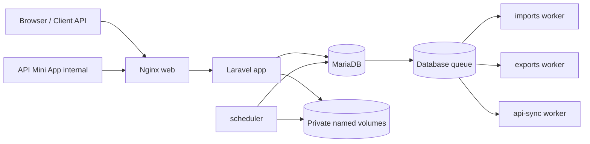
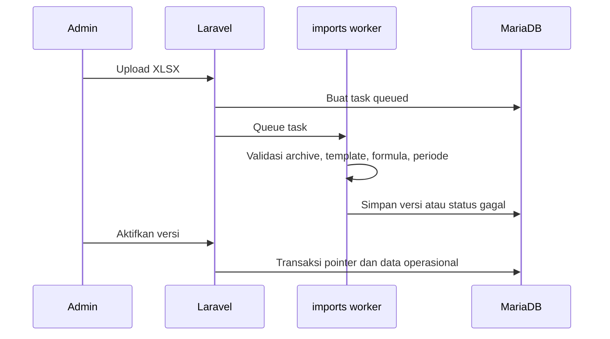

# System Design Sikompen

## Topologi layanan

## Request dan worker

- Request upload hanya menyimpan task dan file sumber; worker `imports` memvalidasi archive/XLSX serta membuat versi.
- Request ekspor membuat task; worker `exports` menulis XLSX/PDF ke private storage.
- Request bulk API membuat sync run; worker `api-sync` menulis artifact NDJSON.GZ.
- Scheduler menjalankan reconciler setiap lima menit serta purge berdasarkan retensi.

Pemecahan queue ini mencegah ekspor atau sync API besar menghambat impor workbook yang dibutuhkan admin.

## Konsistensi data

Aktivasi workbook selalu transaksional. Gagal mencatat audit tidak boleh menandai versi tersimpan sebagai gagal. Task gagal membersihkan file sumber dan pengguna diarahkan untuk upload ulang.

## Keamanan desain

| Batas | Perlindungan |
| --- | --- |
| Browser | Session guard terpisah admin/mahasiswa, CSRF, throttle login/reset, dan redirect aman berbasis route. |
| File | Validasi XLSX termasuk archive entry, ukuran, rasio kompresi, struktur Office XML, template, dan penolakan formula. |
| Storage | File berada di volume private; download melalui controller yang memeriksa akses. |
| API | Bearer token unik, scope, throttle awal sebelum auth, limiter per client, ownership sync run, dan IP allowlist opsional. |
| Proxy | PHP hanya mempercayai CIDR Nginx internal; Nginx hanya menerima header Cloudflare dari network proxy khusus. |
| Audit | Aktivitas domain dicatat ringkas, kredensial disaring, dan retensi menghapus record lama. |

## API provider

API memakai prefix `/api/sikompen/v1`. Client dikonfigurasi lewat `SIKOMPEN_API_CLIENTS_JSON`; rotasi/revoke dilakukan dengan mengubah token pada environment dan recreate aplikasi. `allowed_ips` dapat berisi CIDR egress stabil atau `[]` untuk client token-only yang tidak memiliki egress stabil. Tidak ada header IP kustom yang dipakai sebagai bukti identitas.

## Operasi dan kegagalan

- Task yang lama berada pada status `queued`/`processing` ditandai gagal oleh reconciler berdasarkan ambang konfigurasi.
- Artifact API memakai snapshot database, checksum SHA-256, batas size, retry terbatas, dan masa berlaku 24 jam.
- Hasil ekspor dapat dibatalkan/dismiss dari UI; hasil kedaluwarsa dihapus scheduler.
- Jangan menjalankan `docker compose down -v` pada deployment yang menyimpan data, karena named volume database dan storage akan ikut hilang.
