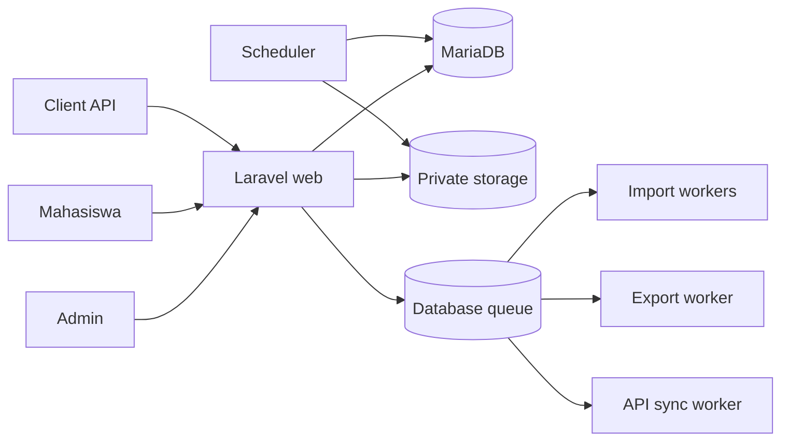
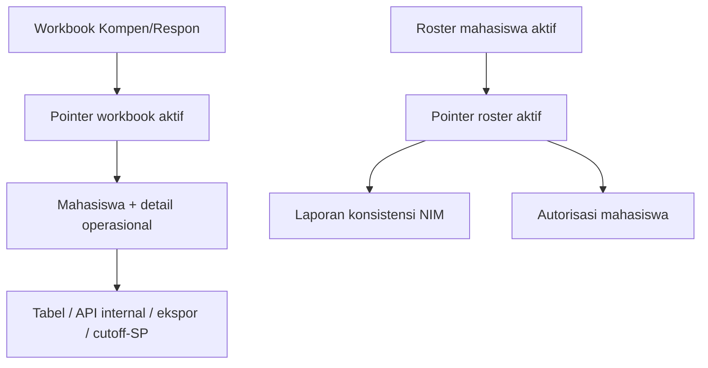

# Arsitektur dan Logika Sistem

## Batas sistem

Sikompen mengelola dua sumber XLSX per periode: workbook Kompen/Respon dan roster mahasiswa aktif. File dan artifact berada di storage private; MariaDB menyimpan metadata, data operasional, pointer versi, dan audit.



## Sumber data per periode



- Mengunggah file menciptakan versi, bukan langsung mengganti data operasional.
- Pointer roster dan pointer workbook bersifat independen, tetapi keduanya dipilih per periode.
- Aktivasi workbook mengganti data operasional periode itu secara transaksional. Periode lain tidak berubah.
- Aktivasi roster hanya mengganti sumber roster periode itu. Roster dipakai untuk akses mahasiswa dan laporan konsistensi, bukan untuk menimpa data Kompen/Respon.

## Lifecycle file

1. Browser mengunggah XLSX dan server membuat task `queued`.
2. Worker memeriksa archive dan template, lalu mem-parsing data bisnis.
3. Jika valid, worker menyimpan versi dan Log Upload; jika gagal, task menyimpan pesan aman dan file sumber gagal dibersihkan.
4. Admin mengaktifkan versi yang telah selesai. Versi inactive dapat dipindahkan ke recycle bin dan dipulihkan selama masa retensi.
5. Versi yang sedang menjadi pointer aktif tidak dapat dihapus. Workbook aktif juga tidak dapat dilepas ketika masih ada SP aktif outstanding pada periodenya.

## Nilai efektif dan koreksi

```text
total efektif = override ringkasan jika ada, selain itu total workbook
jam dikerjakan = progress manual per jenis pekerjaan
sisa jenis pekerjaan = max(0, total efektif - jam dikerjakan)
```

Override ringkasan tidak boleh lebih rendah dari jam yang telah dikerjakan. Progress positif memerlukan waktu terakhir mengerjakan. Koreksi detail tersimpan sebagai override berbasis `source_key`, sehingga baris workbook asli tetap tersedia untuk audit. Setiap perubahan yang relevan menyelaraskan resolusi SP dan masuk ke Riwayat Aktivitas.

## Cutoff dan Surat Peringatan

1. Admin menetapkan cutoff dengan zona `Asia/Jakarta`, minimal lima menit ke depan.
2. Setelah cutoff lewat, mahasiswa dengan sisa hutang efektif masuk kandidat.
3. Admin meninjau kandidat lalu memfinalisasi; hanya saat ini SP `issued` dibuat.
4. Progres hingga lunas menyelesaikan SP tanpa menghapus jejaknya.
5. Admin dapat rollback SP atau finalisasi dengan alasan. Rekam rollback tetap ada untuk audit, tetapi bukan SP aktif.

Finalisasi tidak mengunci data: cutoff, workbook aktif, progress, dan koreksi masih dapat diperbaiki dengan jejak audit.

## Pekerjaan asynchronous

| Pekerjaan | Queue | Hasil |
| --- | --- | --- |
| Impor workbook dan roster | `imports` | Versi file yang menunggu aktivasi. |
| Ekspor XLSX/PDF | `exports` | File private yang hanya dapat diakses pembuat task. |
| API sync massal | `api-sync` | Artifact NDJSON gzip milik client API. |

Task terminal dan artifact memiliki retensi masing-masing. Reconciler menandai task queued/processing yang melewati ambang sebagai gagal sehingga operator dapat mengulang dengan aman.

## Retensi

- Hasil ekspor: `SIKOMPEN_EXPORT_RETENTION_HOURS` (default 24 jam).
- Task impor terminal: `SIKOMPEN_IMPORT_TASK_RETENTION_DAYS` (default 30 hari).
- Artifact dan run API sync: default 24 jam dan 7 hari.
- Riwayat aktivitas dan Log Upload: kebijakan admin, default 90 hari.
- Recycle bin workbook/roster: kebijakan admin, default 30 hari.

Penghapusan terjadwal bersifat permanen setelah retensi lewat. Metadata bisnis lain tidak dihapus oleh kebijakan tersebut kecuali command terkait memang menargetkannya.
