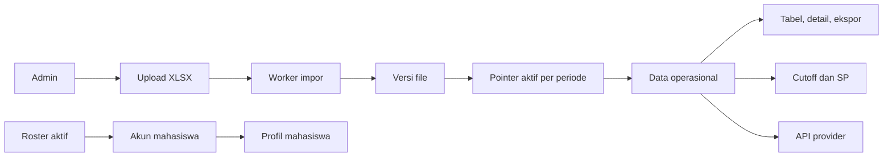

# System Overview Sikompen

## Tujuan

Sikompen adalah hub data untuk pengelolaan Kompen dan Responsi mahasiswa. Sistem memisahkan file sumber, data operasional, koreksi manual, keputusan SP, dan data akun agar perubahan pada satu lapisan tidak merusak lapisan lain.

## Aktor

| Aktor | Hak utama |
| --- | --- |
| Admin reguler | Mengelola file, data, progres, SP, ekspor, retensi, dan reset mahasiswa. |
| Mahasiswa | Melihat profil serta data dirinya sendiri, mengganti password, dan meminta reset password. |
| Admin emergency | Menerbitkan atau membatalkan kode reset untuk admin reguler saja. |
| Client API | Membaca ringkasan Kompen/Respon satu mahasiswa atau artifact bulk melalui token. |

## Alur informasi

## Prinsip kerja

1. Upload menghasilkan versi baru, bukan data aktif secara otomatis.
2. Admin memilih versi aktif pada List File; roster dan workbook memiliki pointer masing-masing.
3. Worker melakukan kerja berat agar request browser singkat dan aman.
4. Progress/override tersimpan sebagai lapisan koreksi ter-audit.
5. Data sementara memiliki retensi agar storage dan tabel task tidak terus bertambah.
6. Hak akses selalu diperiksa backend, termasuk filter mahasiswa berdasarkan NIM sesi.

## Komponen utama

| Komponen | Tanggung jawab |
| --- | --- |
| Laravel/Inertia | Browser admin, mahasiswa, reset akun, dan API provider. |
| MariaDB | Data domain, queue, session, cache, metadata file, dan audit. |
| Private storage | XLSX sumber, ekspor, serta artifact `.ndjson.gz`. |
| Worker | Memproses impor, ekspor, dan sync API tanpa memblokir request. |
| Scheduler | Mendeteksi task macet dan menjalankan purge sesuai retensi. |
| Nginx/Cloudflare Tunnel | Terminasi jalur HTTP publik dan batas trusted proxy. |

## Baca lebih lanjut

- [System design](system-design.md) untuk batas layanan, queue, dan keamanan.
- [ERD](erd.md) untuk relasi data.
- [Panduan fungsionalitas](functionality-guide.md) untuk aturan bisnis.
